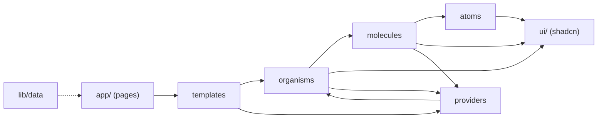

# Components

Components follow **Atomic Design**, layered over the shadcn/ui primitives
([ADR-0005](../decisions/0005-atomic-design-over-shadcn-primitives.md)).
Brad Frost describes it as a mental model, not a strict process. These rules
keep it predictable in this codebase.

## Layers

| Layer | Folder | What belongs here | Examples |
| --- | --- | --- | --- |
| Primitives | `components/ui/` | shadcn components exactly as the CLI generates them | `Button`, `Dialog`, `Tabs`, `Avatar` |
| Atoms | `components/atoms/` | The smallest Ourigin-styled elements, often a wrapper that adds brand variants to a primitive | `Button`, `Pill`, `Heading`, `Icon` |
| Molecules | `components/molecules/` | A few atoms working together as one unit | `SearchField`, `RailItem`, `PostByline` |
| Organisms | `components/organisms/` | A distinct section of the interface | `AppSidebar`, `Feed`, `ContextRail` |
| Templates | `components/templates/` | Page-level layout that arranges organisms, with no content of its own | `AppShell`, `HomeTemplate` |
| Pages | `app/**/page.tsx` | A template filled with real data | `(workplace)/page.tsx` |

Dependencies only point down the hierarchy:

## Rules

1. **Leave `components/ui/` as the shadcn CLI generates it.** Brand styling
   lives in an atom that wraps the primitive (`atoms/button.tsx` wraps
   `ui/button.tsx`). That keeps `npx shadcn@latest add` and `--diff` usable.
   Any layer may use a primitive directly when no brand variant is needed
   (`Feed` uses `ui/tabs`, for example).
2. **Import downwards only.** An atom never imports a molecule; a molecule
   never imports an organism. If a lower layer needs something from a higher
   one, it belongs in the higher layer.
3. **Providers sit beside the layers.** Interactive molecules and organisms
   read context through hooks such as `useDemoDialog` and `useHomeFeed`.
   Providers may render organisms they own, for example the compose and
   customize dialogs rendered by `HomeFeedProvider`.
4. **Templates have no content.** Copy and data come in as props from the page,
   or from `lib/data` for static reference data such as navigation.
5. **One component family per file**, named in kebab-case, with named exports.
   There are no barrel (`index.ts`) files: direct imports keep client bundles
   small and boundaries obvious.

## Server and client components

Components are Server Components unless they need state, effects or event
handlers. A file with `"use client"` makes everything it imports part of the
client bundle, so keep the directive on the smallest component that needs it.
Server components can still be passed as `children` into client components:
`HomeTemplate` renders the server-side `ContextRail` inside the client
`HomeFeedProvider`.

## Inventory

`Client` means the file declares `"use client"`.

### Atoms

| Component | File | Client | Purpose |
| --- | --- | --- | --- |
| `Button` | `atoms/button.tsx` | | Ourigin tones (`primary`, `soft`, `plain`) over `ui/button` |
| `Heading` | `atoms/heading.tsx` | | Manrope headings: `page`, `feature`, `post`, `recognition`, `panel` |
| `Icon` | `atoms/icon.tsx` | | 29 two-tone icons, sized and coloured with classes |
| `BrandSymbol`, `Wordmark` | `atoms/logo.tsx` | | The symbol (next/image) and the lowercase wordmark |
| `Medal` | `atoms/medal.tsx` | | Trophy medal with ribbon on recognition posts |
| `Pill` | `atoms/pill.tsx` | | Status pills and the navigation counter over `ui/badge` |
| `Surface` | `atoms/surface.tsx` | | White card with Ourigin radius and shadow; supports `asChild` |
| `UserAvatar` | `atoms/user-avatar.tsx` | | Photo or initials over `ui/avatar` |

### Molecules

| Component | File | Client | Purpose |
| --- | --- | --- | --- |
| `Callout` | `molecules/callout.tsx` | ✓ | Tinted block in a post with an action (opportunity, profile) |
| `ContextPanel` | `molecules/context-panel.tsx` | | Card with heading and optional badge or link, used in the context rail |
| `EmptyState` | `molecules/empty-state.tsx` | | Icon, heading, text and action for empty or placeholder views |
| `EventItem` | `molecules/event-item.tsx` | ✓ | Time-boxed entry in the "Today" panel |
| `LinkedWork` | `molecules/linked-work.tsx` | ✓ | Shared work attached to a post, with a photo from `md` up |
| `NavLink` | `molecules/nav-link.tsx` | ✓ | Sidebar row or bottom-bar tab; tooltip when collapsed |
| `PageHeading` | `molecules/page-heading.tsx` | | Workspace eyebrow, `h1`, description and an action slot |
| `PostActions` | `molecules/post-actions.tsx` | ✓ | Reactions, comments, Appreciate, Reply, Save |
| `PostByline` | `molecules/post-byline.tsx` | ✓ | Author, meta line and the post menu button |
| `PostText` | `molecules/post-text.tsx` | | Post copy with one line per entry |
| `PreviewDialog` | `molecules/preview-dialog.tsx` | ✓ | The Ourigin modal, composed from shadcn dialog parts |
| `RailItem` | `molecules/rail-item.tsx` | ✓ | A row in a context panel that opens its destination |
| `SearchField` | `molecules/search-field.tsx` | ✓ | Workplace search with ⌘K; collapses to an icon on phones |

### Organisms

| Component | File | Client | Purpose |
| --- | --- | --- | --- |
| `AppSidebar` | `organisms/app-sidebar.tsx` | ✓ | Collapsible sidebar from `md` up; bottom tab bar on phones |
| `AppToaster` | `organisms/app-toaster.tsx` | | Brand-styled Sonner toaster |
| `ComposeDialog` | `organisms/compose-dialog.tsx` | ✓ | Write a post or reply into the preview |
| `Composer` | `organisms/composer.tsx` | ✓ | The "Share progress…" card and its quick actions |
| `ContextRail` | `organisms/context-rail.tsx` | | All context panels (attention, today, connected work and more) |
| `CustomizeFeedDialog` | `organisms/customize-feed-dialog.tsx` | ✓ | Show or hide recognition and profile posts |
| `CustomizeFeedButton`, `OpenSavedButton` | `organisms/feed-controls.tsx` | ✓ | Feed controls that live outside the feed itself |
| `Feed` | `organisms/feed.tsx` | ✓ | Tabs, filtered posts, empty message and end-of-feed note |
| `PostCard` | `organisms/posts/post-card.tsx` | ✓ | Renders each post kind: announcement, recognition, decision, opportunity, profile, draft |
| `TopBar` | `organisms/top-bar.tsx` | ✓ | Brand, search, notifications, help and profile |

### Templates

| Component | File | Purpose |
| --- | --- | --- |
| `AppShell` | `templates/app-shell.tsx` | Full-viewport shell: sidebar, top bar, skip link and `<main>` |
| `HomeTemplate` | `templates/home-template.tsx` | Page heading plus the feed and context rail columns |
| `SectionTemplate` | `templates/section-template.tsx` | Placeholder page for an unbuilt section |

### Providers

| Provider | File | Purpose |
| --- | --- | --- |
| `FeedViewProvider` | `providers/feed-view-provider.tsx` | Search query and active feed tab |
| `DemoDialogProvider` | `providers/demo-dialog-provider.tsx` | The illustrative "destination" dialog |
| `HomeFeedProvider` | `providers/home-feed-provider.tsx` | Saved and appreciated posts, drafts, preferences; renders the compose and customize dialogs |

See [state and data](state-and-data.md) for how these fit together.

### shadcn primitives in use

`avatar`, `badge`, `button`, `checkbox`, `dialog`, `kbd`, `label`, `sonner`,
`tabs`, `textarea`, `tooltip`. Add more with
`npx shadcn@latest add <name>`; see
[adding components](../guides/adding-components.md).
