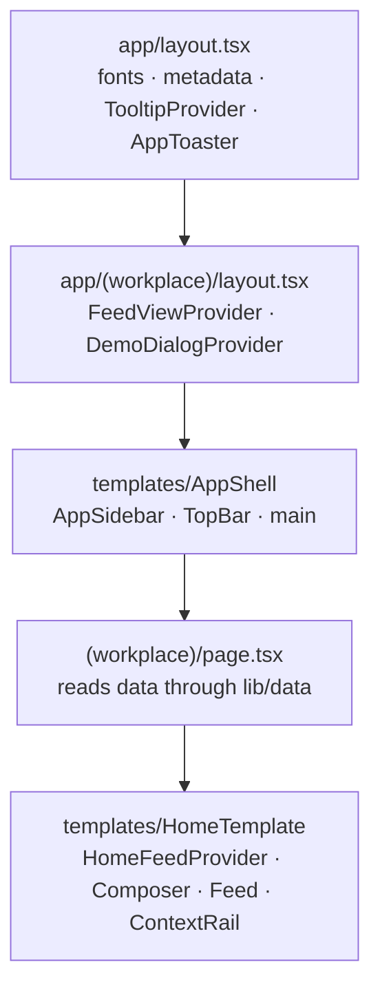

# Architecture overview

Ourigin is a people-centred enterprise workplace for employees, teams and
leaders. The frontend renders the workplace shell and the Home feed from the
brand identity proposal's **"New design proposal"**
([ADR-0002](../decisions/0002-build-the-new-design-proposal.md)). It uses
illustrative data until an API exists.

## Stack

| Concern | Choice | Version | Decision |
| --- | --- | --- | --- |
| Framework | Next.js App Router, Turbopack, Cache Components | 16.4.5 | [ADR-0003](../decisions/0003-nextjs-app-router-with-cache-components.md) |
| UI runtime | React | 19.3.0 | |
| Language | TypeScript (strict) | 5.x | |
| Styling | Tailwind CSS (CSS-first config in `globals.css`) | 4.x | [ADR-0006](../decisions/0006-brand-tokens-and-design-breakpoints.md) |
| Component primitives | shadcn/ui, `radix-nova` style on Radix (`radix-ui`) | CLI 4.23, radix-ui 1.8 | [ADR-0004](../decisions/0004-shadcn-ui-on-radix.md) |
| Component structure | Atomic Design layered over shadcn | | [ADR-0005](../decisions/0005-atomic-design-over-shadcn-primitives.md) |
| Class merging | `cn` (shadcn's replacement for clsx + tailwind-merge) | 0.5 | |
| Variants | class-variance-authority | 0.7 | |
| Toasts | Sonner, through the shadcn wrapper | 2.x | |
| Icons | Custom two-tone set in `atoms/icon.tsx` | | [ADR-0007](../decisions/0007-custom-duotone-icon-set.md) |
| Fonts | Manrope and Inter via `next/font/google` | | |
| Linting | ESLint with `eslint-config-next` | 9.x | |
| Package manager | npm | 11.x | [ADR-0012](../decisions/0012-npm-as-package-manager.md) |

## Rendering model

- **Server Components by default.** Routes, layouts, templates and most
  presentational pieces render on the server. `"use client"` is used only where
  a component needs state, effects or event handlers. See
  [components](components.md#server-and-client-components).
- **Everything is prerendered.** With Cache Components on, every route,
  including Home, is built as static content. Pages read data through async
  getters that need no request-time information, so nothing has to stream.
- **Navigation keeps state.** Cache Components keeps up to three visited routes
  alive with React `<Activity>`, hidden rather than unmounted. Home's feed
  state survives a trip to `/inbox` and back. See
  [state and data](state-and-data.md#route-preservation).
- **Partial prefetching** is on (the `create-next-app` default for this
  version).

## Routes

| Route | File | Renders |
| --- | --- | --- |
| `/` | `src/app/(workplace)/page.tsx` | `HomeTemplate` with feed and context data |
| `/inbox`, `/calendar`, `/messages`, `/organization`, `/goals`, `/people`, `/resources` | `src/app/(workplace)/<section>/page.tsx` | `SectionTemplate` placeholder ([ADR-0010](../decisions/0010-placeholder-routes-for-unbuilt-sections.md)) |
| Unknown URLs | `src/app/not-found.tsx` | Branded not-found page, outside the workplace shell |
| `/icon.png`, `/apple-icon.png` | `src/app/icon.png`, `src/app/apple-icon.png` | App icons (metadata file convention) |

How a request is composed:



- **Root layout:** sets `lang`, loads fonts as CSS variables (`--font-inter`,
  `--font-manrope`), and defines the metadata title template (`%s · Ourigin`)
  and viewport (`viewportFit: "cover"` for the iPhone safe areas). It also
  mounts the tooltip provider and the toaster.
- **`(workplace)` route group:** shares the shell and the workplace-wide
  providers without adding a URL segment.

## Folder structure

```
.
├── docs/                         Living documentation (this folder)
├── public/                       Static files served as-is (currently empty)
├── src/
│   ├── app/                      Routes: the "pages" layer of Atomic Design
│   │   ├── layout.tsx
│   │   ├── globals.css           Tailwind, theme tokens, breakpoints
│   │   ├── not-found.tsx
│   │   ├── icon.png, apple-icon.png
│   │   └── (workplace)/          Route group sharing the workplace shell
│   ├── assets/                   Images imported statically by next/image
│   ├── components/
│   │   ├── ui/                   shadcn primitives (CLI-managed)
│   │   ├── atoms/
│   │   ├── molecules/
│   │   ├── organisms/
│   │   └── templates/
│   ├── providers/                Client-side React context providers
│   ├── lib/
│   │   ├── utils.ts              cn()
│   │   └── data/                 Data access layer and fixtures
│   └── types/                    Domain types
├── AGENTS.md                     Next.js guidance for coding agents (maintained by next dev)
├── components.json               shadcn configuration
├── eslint.config.mjs
├── next.config.ts
└── tsconfig.json                 `@/*` → `src/*`
```

## Configuration

| File | Notable settings |
| --- | --- |
| `next.config.ts` | `cacheComponents: true`, `partialPrefetching: true`, Tailwind compiled through the `@tailwindcss/turbopack` loader |
| `components.json` | Style `radix-nova`, RSC on, CSS variables on, Lucide icon library, aliases: `ui` → `@/components/ui`, `utils` → `@/lib/utils`, `hooks` → `@/hooks` |
| `tsconfig.json` | Strict mode, `@/*` path alias to `./src/*` |
| `src/app/globals.css` | Theme tokens, custom breakpoints, `bg-backdrop` utility, base focus styles. See [foundations](../design-system/foundations.md) |
