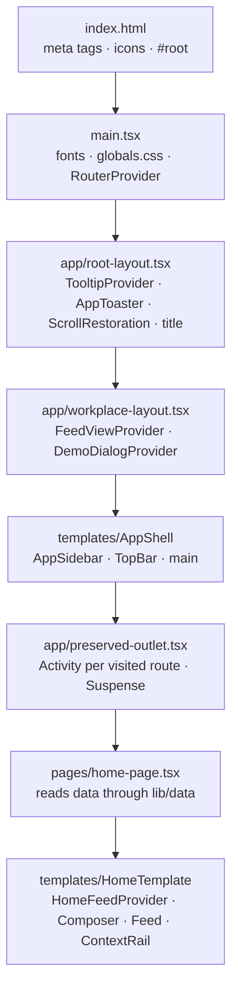

# Architecture overview

Ourigin is a people-centred enterprise workplace for employees, teams and
leaders. The frontend renders the workplace shell and the Home feed from the
brand identity proposal's **"New design proposal"**
([ADR-0002](../decisions/0002-build-the-new-design-proposal.md)). It uses
illustrative data until an API exists. The API is planned as a separate NestJS
service with PostgreSQL; this repository stays frontend-only.

## Stack

| Concern | Choice | Version | Decision |
| --- | --- | --- | --- |
| Build tool and dev server | Vite (`@vitejs/plugin-react`) | 8.3 | [ADR-0013](../decisions/0013-vite-and-react-router-instead-of-nextjs.md) |
| Routing | React Router, data mode (`createBrowserRouter`) | 8.5 | [ADR-0013](../decisions/0013-vite-and-react-router-instead-of-nextjs.md) |
| UI runtime | React | 19.3.0 | |
| Language | TypeScript (strict) | 5.x | |
| Styling | Tailwind CSS (CSS-first config in `src/styles/globals.css`, `@tailwindcss/vite`) | 4.3.3 | [ADR-0006](../decisions/0006-brand-tokens-and-design-breakpoints.md), [ADR-0015](../decisions/0015-type-scale-tokens.md) |
| Component primitives | shadcn/ui, `radix-nova` style on Radix (`radix-ui`) | CLI 4.23, radix-ui 1.8 | [ADR-0004](../decisions/0004-shadcn-ui-on-radix.md) |
| Component structure | Atomic Design layered over shadcn | | [ADR-0005](../decisions/0005-atomic-design-over-shadcn-primitives.md) |
| Class merging | `cn` (shadcn's replacement for clsx + tailwind-merge) | 0.5 | |
| Variants | class-variance-authority | 0.7 | |
| Toasts | Sonner, through the shadcn wrapper | 2.x | |
| Icons | Custom two-tone set in `atoms/icon.tsx`; Lucide inside shadcn primitives, the account menu and the sidebar toggle | | [ADR-0007](../decisions/0007-custom-duotone-icon-set.md), [ADR-0014](../decisions/0014-lucide-icons-for-standard-controls.md) |
| Fonts | Inter and Manrope, self-hosted variable fonts from Fontsource | 5.3 | |
| Linting | ESLint with `typescript-eslint`, `react-hooks`, `react-refresh` | 9.x | |
| Package manager | npm | 11.x | [ADR-0012](../decisions/0012-npm-as-package-manager.md) |

## Rendering model

- **Client-side rendering.** `index.html` loads `src/main.tsx`, which mounts
  `<RouterProvider>` into `#root`. Nothing is prerendered, so hosting must
  serve `index.html` for every path (an SPA fallback).
- **Navigation keeps state.** `PreservedOutlet` keeps the three most recently
  visited routes mounted inside a hidden React `<Activity>` instead of
  unmounting them. Home's feed state survives a trip to `/inbox` and back. See
  [state and data](state-and-data.md#route-preservation).
- **Scroll.** React Router's `<ScrollRestoration>` starts every new page at the
  top and restores the position on Back and Forward.
- **Page titles** come from each route's `handle.title`, written to
  `document.title` as `<title> · Ourigin`. Unnamed routes show "Ourigin".

## Routes

The route table is `src/app/router.tsx`.

| Route | Element | Renders |
| --- | --- | --- |
| `/` | `HomePage` (`src/pages/home-page.tsx`) | `HomeTemplate` with feed and context data |
| `/inbox`, `/calendar`, `/messages`, `/organization`, `/goals`, `/people`, `/resources` | `SectionPage` (`src/pages/section-page.tsx`), one route per navigation item | `SectionTemplate` placeholder ([ADR-0010](../decisions/0010-placeholder-routes-for-unbuilt-sections.md)) |
| Anything else (`*`) | `NotFoundPage` (`src/pages/not-found-page.tsx`) | Branded not-found page, outside the workplace shell |
| `/icon.png`, `/apple-icon.png` | `public/` | App icons, linked from `index.html` |

How a page is composed:



- **`index.html`:** sets `lang`, the description, the theme colour, the app
  icons and the viewport (`viewport-fit=cover` for the iPhone safe areas).
- **Root layout:** mounts the tooltip provider, the toaster and scroll
  restoration, and keeps the document title in step with the route.
- **Workplace layout:** a pathless layout route that shares the shell and the
  workplace-wide providers without adding a URL segment.

## Folder structure

```
.
├── docs/                         Living documentation (this folder)
├── public/                       Static files served as-is: icon.png, apple-icon.png
├── src/
│   ├── main.tsx                  Entry: fonts, global CSS, RouterProvider
│   ├── app/                      Route table and layouts
│   │   ├── router.tsx
│   │   ├── root-layout.tsx
│   │   ├── workplace-layout.tsx
│   │   └── preserved-outlet.tsx
│   ├── pages/                    The "pages" layer of Atomic Design
│   ├── styles/globals.css        Tailwind, theme tokens, breakpoints
│   ├── assets/                   Images imported statically (Vite returns their URL)
│   ├── components/
│   │   ├── ui/                   shadcn primitives (CLI-managed)
│   │   ├── atoms/
│   │   ├── molecules/
│   │   ├── organisms/
│   │   └── templates/
│   ├── providers/                React context providers
│   ├── lib/
│   │   ├── utils.ts              cn()
│   │   └── data/                 Data access layer and fixtures
│   └── types/                    Domain types
├── index.html                    HTML entry and document metadata
├── .github/workflows/            Deploy to GitHub Pages (deploy-pages.yml)
├── components.json               shadcn configuration
├── eslint.config.js
├── vite.config.ts
├── tsconfig.json                 References tsconfig.app.json (src) and tsconfig.node.json (vite.config.ts)
└── package.json
```

## Configuration

| File | Notable settings |
| --- | --- |
| `vite.config.ts` | React and Tailwind plugins; `resolve.tsconfigPaths` for the `@/*` alias; dev server on port 3000 |
| `tsconfig.app.json` | Strict mode, `vite/client` types (static asset imports), `@/*` → `./src/*`, `verbatimModuleSyntax` |
| `tsconfig.json` | Project references, plus the `@/*` path repeated from `tsconfig.app.json` so the shadcn CLI resolves its aliases |
| `components.json` | Style `radix-nova`, RSC off, CSS variables on, CSS file `src/styles/globals.css`, Lucide icon library, aliases: `ui` → `@/components/ui`, `utils` → `@/lib/utils`, `hooks` → `@/hooks` |
| `eslint.config.js` | Vite's recommended rules. `react-refresh/only-export-components` is off for `components/ui/` and `providers/`, which export variants or hooks beside components |
| `package.json` | `overrides` keeps `@babel/plugin-transform-runtime` on Babel 7 ([ADR-0013](../decisions/0013-vite-and-react-router-instead-of-nextjs.md#consequences)) |
| `src/styles/globals.css` | Theme tokens, font variables, custom breakpoints, `bg-backdrop` utility, base focus styles. See [foundations](../design-system/foundations.md) |
