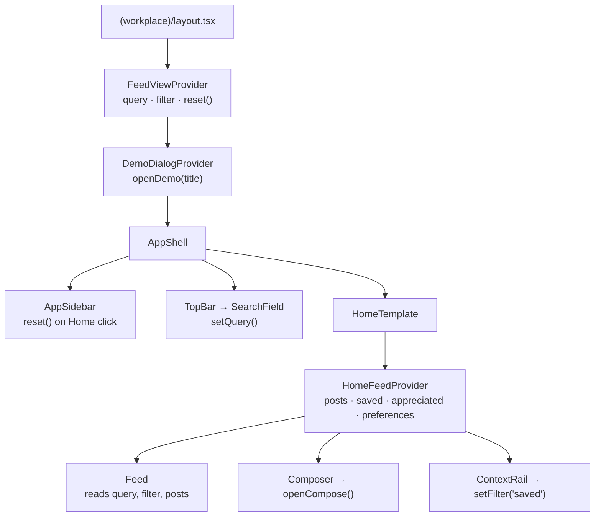

# State and data

## Server/client boundary

- Pages and templates are Server Components. Pages fetch data through
  `src/lib/data` and pass it down as **serialisable props**: plain objects,
  strings, and statically imported images.
- Interactive state lives in client **providers** ([ADR-0008](../decisions/0008-scoped-react-context-for-client-state.md)).
  There is no global store and nothing is persisted: a full page reload resets
  the preview.

## Providers

Each provider is mounted at the closest common parent of the components that
use it.

| Provider | Mounted in | State | Written by | Read by |
| --- | --- | --- | --- | --- |
| `FeedViewProvider` | `(workplace)/layout.tsx` | `query`, `filter` (`following` · `highlights` · `saved`) | `SearchField`, the sidebar's Home link (`reset`), `Feed` tabs, `OpenSavedButton`, a new post (back to Following) | `Feed` |
| `DemoDialogProvider` | `(workplace)/layout.tsx` | Open state and title of the demo dialog | Any `RailItem`, `EventItem`, `PostByline` menu, `LinkedWork`, `Callout`, top-bar button | Renders `PreviewDialog` |
| `HomeFeedProvider` | `HomeTemplate` | Drafts, saved IDs, appreciated IDs, `showRecognition` / `showProfiles`, compose and customize dialog state | Post actions, `Composer`, `CustomizeFeedDialog` | `Feed`, post cards |

Why two levels: the search box (top bar) and the Home link (sidebar) are in the
shell, but the posts belong to Home. Search and the active tab therefore live
in the layout, while post state stays with the Home template.

### Feed filtering

`Feed` shows a post when all of these are true:

1. It isn't hidden by a preference (recognition and profile posts can be
   switched off in **Customize feed**).
2. It matches the tab: **Following** shows everything, **Highlights** shows
   posts marked `highlight`, and **Saved** shows posts the user saved.
3. Its searchable text contains the trimmed, lowercased query. The searchable
   text is the author, meta line, title, body and the post kind's own fields.

### Route preservation

With Cache Components, Next.js hides up to three recently visited routes with
React `<Activity>` instead of unmounting them. As a result:

- Home's drafts, saved posts and preferences survive navigation to a placeholder
  route and back.
- Layout providers (`FeedViewProvider`) persist across every route in the group.
- If a component should reset when hidden (for example a dropdown left open),
  close it in a `useLayoutEffect` cleanup, as described in the bundled guide
  `node_modules/next/dist/docs/01-app/02-guides/preserving-ui-state.md`.

## Data access layer

[ADR-0009](../decisions/0009-data-access-layer-over-fixtures.md)

| File | Contents | Imported by |
| --- | --- | --- |
| `lib/data/index.ts` | `getHomeFeed()`, `getWorkplaceContext()`; marked `server-only` | Pages only |
| `lib/data/home-feed.ts` | The five illustrative posts | `index.ts` |
| `lib/data/workplace-context.ts` | Context rail content | `index.ts` |
| `lib/data/people.ts` | `viewer`, `priya`, `amira`, `operationsAndEngineering`, `workspace` | Fixtures and components that show the signed-in user |
| `lib/data/navigation.ts` | Navigation groups, section descriptions, `getNavItem()` | `AppSidebar`, placeholder pages |
| `lib/data/demo-details.ts` | Copy for demo dialogs, `getDemoDetail()` | `DemoDialogProvider` |
| `types/workplace.ts` | `Person`, `NavItem`, `FeedPost` union, `WorkplaceContext`… | Everywhere |

**Page data** (posts and rail content) goes through the async getters, so it
can be replaced with real requests without touching components. **Reference
data** (navigation, the signed-in user, demo copy) is imported directly
because client components need it.

### Connecting a real API

1. Keep the getter signatures and return types from `types/workplace.ts`.
2. Replace the fixture return with a request. Under Cache Components, cache it
   with the `'use cache'` directive and `cacheLife`, or wrap the dynamic part
   of the page in `<Suspense>`. See the bundled guide
   `node_modules/next/dist/docs/01-app/01-getting-started/08-caching.md`.
3. Image URLs from an API need `images.remotePatterns` in `next.config.ts`.
4. Record the change in [progress.md](../progress.md), and in an ADR if it
   changes the approach.
